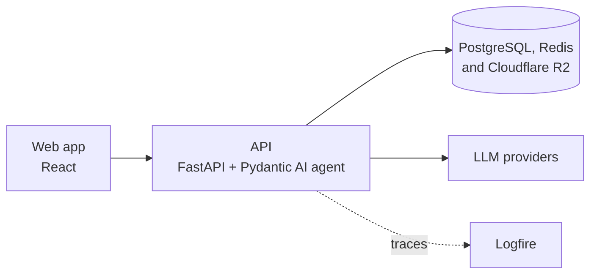

# AI-Hub

A live LLM chat backend, run the way production teams run theirs: every
request is traced, every prompt change is scored by evals, and any user's
failed request can be [found in a minute](docs/debugging-a-failed-reply.md).

[](https://github.com/mekanbaymyradov/AI-Hub/actions/workflows/ci.yml)
[](pyproject.toml)
[](LICENSE)
[](https://github.com/astral-sh/ruff)

**Live:** [ai-hub.techship.fun](https://ai-hub.techship.fun/)

I built it to learn how FastAPI serves AI agents and why observability
matters, so it's held to the standards I'd use at work: typed and tested code,
migrations, CI/CD, alerts and evals.

## What's interesting here

- **Tracing that keeps user data out.** Each request is one Logfire trace, with
  its SQL, Redis, R2, outgoing HTTP and agent calls as child spans, and
  signed-in requests carry the user's ID. Production traces record the model,
  tokens and timing but never chat text. Log messages are fixed templates, so
  alerts can match on them.
  ([code](src/observability.py), [details](docs/architecture.md#logging-and-observability))
- **Agent replies streamed through FastAPI.** Pydantic AI runs the agent and
  streams its reply in the Vercel AI SDK's protocol. The database is the only
  record of a chat's history, provider errors are replaced before they reach
  the client, and when the weather service is down, the tool tells the model
  instead of failing the reply.
  ([code](src/chat/adapter.py), [tools](src/llm/tools.py), [details](docs/architecture.md#streaming))
- **Sessions that catch stolen tokens.** Sign-in is passwordless. Refresh
  tokens rotate on every use, and replaying one that was already rotated
  revokes the whole session.
  ([code](src/auth/sessions.py), [details](docs/architecture.md#auth))
- **Evals that score every prompt change.** Each model answers a fixed set of
  questions, and the answers are graded by code checks and an LLM judge built
  on pydantic_evals. Every run lands in Logfire as an experiment to compare
  against the last, and retries with backoff keep it within free-tier rate
  limits.
  ([code](evals/), [cases](evals/cases.yaml))
- **Attachments without races.** Files are uploaded before the message,
  claimed once, and read through signed URLs. An hourly job removes unclaimed
  uploads, deleting rows before files so it can't remove a file that a message
  is claiming at that moment.
  ([code](src/chat/schedule.py), [details](docs/architecture.md#attachments))

## One reply, end to end

A question on the live site that needs a tool to answer:


The whole reply is one trace in Logfire, 2 seconds end to end. Two Redis
rate-limit checks and the loading of the user, chat and history come first.
Then the agent runs: the model asks for `get_weather`, the tool calls
Open-Meteo, and a second model call writes the answer. Last, the reply is saved
and a smaller agent names the chat.


Production keeps the model, tokens and cost, but not the conversation: the
question and the tool's arguments show as "Not captured".


## Fixed upstream along the way

- **OpenTelemetry** ([#5246](https://github.com/open-telemetry/opentelemetry-python-contrib/pull/5246)):
  the health check reads the database inside `suppress_instrumentation()`, and
  that drove the SQLAlchemy connection-pool metric negative in production. The
  instrumentation now keeps checkouts and checkins paired.
- **Logfire** ([#2609](https://github.com/pydantic/logfire/pull/2609)): Logfire
  has no helper for botocore, so R2 is traced through a hand-wired OpenTelemetry
  instrumentor. `logfire run` now falls back to OpenTelemetry's instrumentors
  for botocore and 18 other packages.
- **Pydantic AI** ([#10306](https://github.com/pydantic/pydantic-ai/pull/10306)):
  Pydantic AI still listed Groq models that Groq had shut down; four of them
  are now removed.

## Architecture

Everything runs with Docker Compose on one server, and a version tag deploys
it. The agent runs inside the API process, so a reply is one request from the
browser's side and one trace in Logfire.



## Features

- Chat with Anthropic, OpenAI, Google, Groq and Mistral models through one API;
  providers without an API key are left out
- Tools for the time, weather and web search, with the running tool shown in
  the chat
- Reasoning effort per message, and regenerating the last reply
- Image and PDF attachments, and voice input transcribed by Whisper
- Passwordless sign-in, custom instructions, avatars and paginated chat history

## Tech stack

- **API:** FastAPI, Pydantic
- **LLM:** Pydantic AI, pydantic_evals
- **Data:** PostgreSQL, SQLAlchemy (async), Alembic, Redis
- **Storage:** Cloudflare R2 (S3 API)
- **Email:** Resend
- **Observability:** Logfire, OpenTelemetry Collector
- **CI/CD:** GitHub Actions runs Ruff, ty, pytest, a Docker Compose smoke test
  and a migration check on every pull request; a version tag reruns them and
  deploys to the server
- **Tooling:** uv, Docker Compose, supercronic

## Getting started

Needs [Docker](https://docs.docker.com/get-docker/) and [uv](https://docs.astral.sh/uv/).

```bash
cp .env.example .env    # then fill in the keys, see docs/development.md
docker compose -f docker-compose.dev.yaml --profile frontend up --watch

# in a second terminal
uv run alembic upgrade head
```

- App: http://localhost:5173
- API docs: http://localhost:8000/docs

Run the tests with `uv run pytest`, and the evals with
`uv run python -m evals --name <prompt version>`. The evals need a Groq key for
the judge and a Logfire token.

## Docs

- [Development guide](docs/development.md): configuration, migrations, jobs, tests
- [Architecture](docs/architecture.md): how auth, streaming, attachments and the infrastructure work
- [Debugging a failed reply](docs/debugging-a-failed-reply.md): find why a user's reply failed, what to tell them and what to fix
- [Research notes](docs/RESEARCH.md)

## Next

- Move the system prompt into Logfire as a managed prompt, so it can change
  without a deploy
- Track token cost per user and per model, from the usage already in the traces
- Fall back to another provider when one fails

## Credits

I built the backend, infrastructure, evals and tests;
[yunus770](https://github.com/yunus770) built most of the React web app.

The project was inspired by:

- [Netflix Dispatch](https://github.com/Netflix/dispatch/tree/main/src/dispatch): the architecture, one package per domain
- [FastAPI Best Practices](https://github.com/zhanymkanov/fastapi-best-practices): project structure and conventions by [@zhanymkanov](https://github.com/zhanymkanov)
- [FastAPI Tips](https://github.com/Kludex/fastapi-tips): tips from [@Kludex](https://github.com/Kludex), the FastAPI expert
