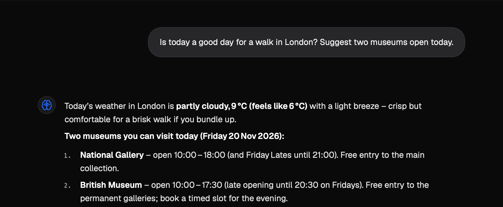
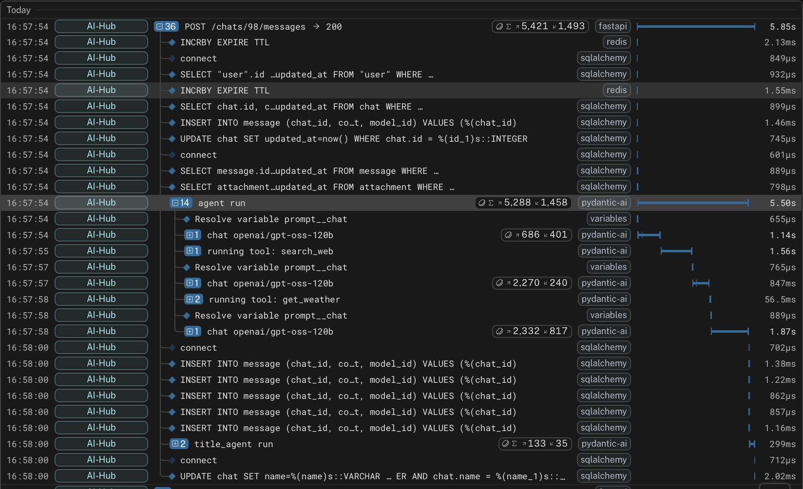

# AI-Hub

A live LLM chat backend, run like a production service: every request traced,
every prompt change scored by evals before it ships, and any failed reply
[found in a minute](docs/debugging-a-failed-reply.md).

[](https://github.com/mekanbaymyradov/ai-hub/actions/workflows/ci.yml)
[](pyproject.toml)
[](LICENSE)
[](https://github.com/astral-sh/ruff)

**Live:** [ai-hub.techship.fun](https://ai-hub.techship.fun/)

I built it to learn how FastAPI serves AI agents, and held it to the standards
I'd use at work.

## What's interesting here

- **Prompt changes are measured before they ship.** The prompt lives in Logfire,
  and evals score each new version before it replaces the live one, with no
  deploy. The current prompt lifted "answers first" from 69% to 90% with
  correctness unchanged; the first draft scored 62% and never shipped.
  ([how](docs/architecture.md#prompt-and-evals))
- **Product and system health on one dashboard.** Active users, LLM cost per
  user and model, and time to first token sit next to errors, latency per
  release and container memory. Ten alerts watch it, and Logfire Fleet changes
  sampling and log levels without a redeploy.
  ([dashboard](docs/architecture.md#logging-and-observability))
- **A failed search no longer kills the reply.** 4 of 15 web searches failed and
  took the whole answer down; now the model is told the search failed and
  answers anyway. ([code](src/llm/tools.py))
- **A failed reply returns HTTP 200, and still gets found.** The stream starts
  before the model can fail, so 5xx alerts miss it. A dedicated alert names the
  cause, and the user gets an Error ID that opens the trace in Logfire.
  ([guide](docs/debugging-a-failed-reply.md))

## One reply, end to end

A question that needs a web search and a tool:



One trace, 5.9 seconds: the prompt read from Logfire, a web search, a weather
lookup, then the answer.



## Architecture

Everything runs with Docker Compose on one server, and a version tag deploys it.
Logfire receives the telemetry and sends back the live prompt and Fleet's
settings.


## Features

- Chat with Anthropic, OpenAI, Google, Groq and Mistral models
- Tools for the time, weather and web search
- Reasoning effort, reply regeneration, image and PDF attachments, voice input
- Passwordless sign-in, custom instructions, chat search and history
- Interface in English, Russian and Turkmen

## Tech stack

- **API:** FastAPI, Pydantic
- **LLM:** Pydantic AI, pydantic_evals, Tavily
- **Data:** PostgreSQL, SQLAlchemy (async), Alembic, Redis
- **Storage:** Cloudflare R2 (S3 API)
- **Email:** Resend
- **Observability:** Logfire (traces, dashboards, alerts, managed prompts,
  Fleet), OpenTelemetry Collector
- **CI/CD:** GitHub Actions for lint, types, tests and a Compose smoke test;
  version tags deploy
- **Tooling:** uv, Docker Compose, supercronic

## Getting started

Needs [Docker](https://docs.docker.com/get-docker/) and [uv](https://docs.astral.sh/uv/).

```bash
cp .env.example .env    # then fill in the keys, see docs/development.md
docker compose -f docker-compose.dev.yaml --profile frontend up --watch

# in a second terminal
uv run alembic upgrade head
```

- App: http://localhost:5173
- API docs: http://localhost:8000/docs

Run the tests with `uv run pytest`, and the evals with
`uv run python -m evals --name <run> --label candidate` (needs Groq and Logfire
keys, see [docs/development.md](docs/development.md)).

## Docs

- [Development guide](docs/development.md): setup, migrations, jobs, tests
- [Architecture](docs/architecture.md): how each part works
- [Debugging a failed reply](docs/debugging-a-failed-reply.md): from a user's report to the fix
- [Research notes](docs/RESEARCH.md)

## Next

- Fall back to another provider when one fails
- 👍/👎 on replies, turning bad answers into new eval cases
- Host metrics, so a full disk raises an alert
- A report button that sends the Error ID to support

## Credits

I built the backend, infrastructure, evals and tests;
[yunus770](https://github.com/yunus770) built most of the React web app.

Inspired by:

- [Netflix Dispatch](https://github.com/Netflix/dispatch/tree/main/src/dispatch): one package per domain
- [FastAPI Best Practices](https://github.com/zhanymkanov/fastapi-best-practices) by [@zhanymkanov](https://github.com/zhanymkanov)
- [FastAPI Tips](https://github.com/Kludex/fastapi-tips) by [@Kludex](https://github.com/Kludex)
