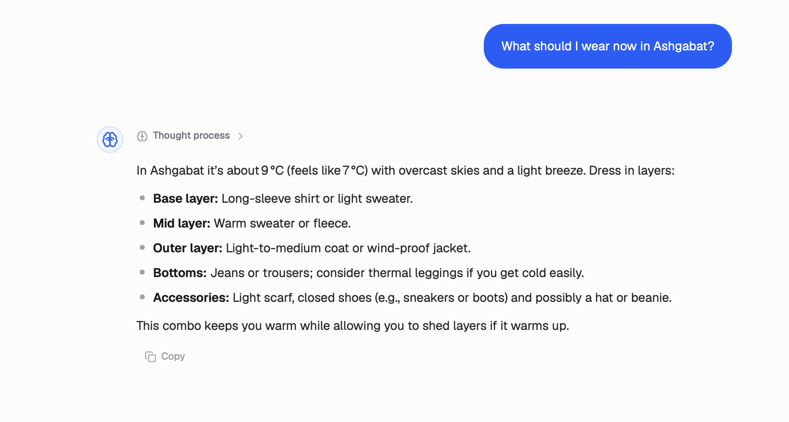
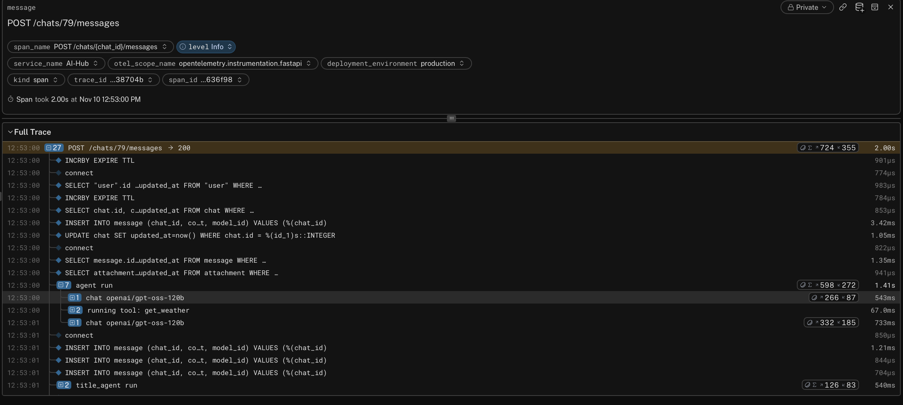
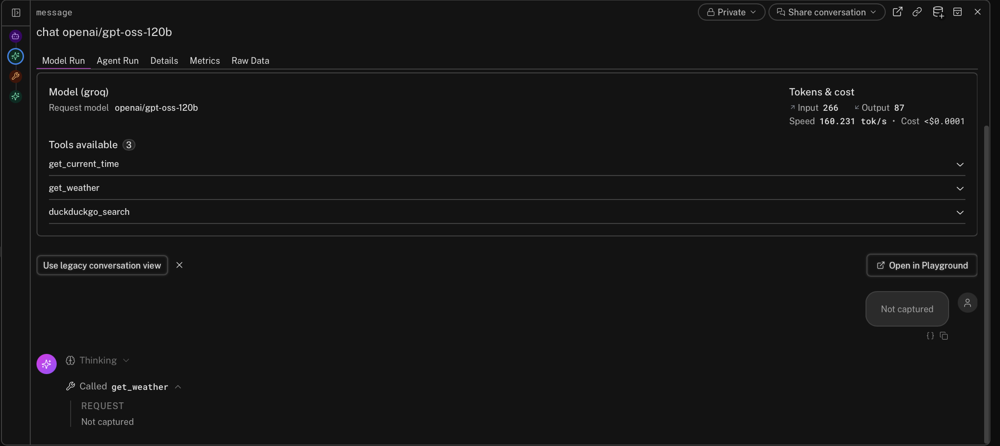
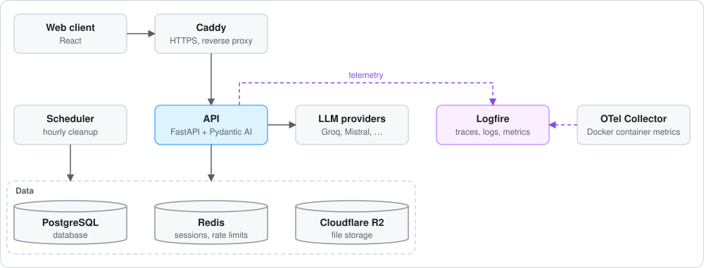

# AI-Hub

A live LLM chat backend, run like a production service: every request traced,
every prompt change scored by evals, and any failed reply
[found in a minute](docs/debugging-a-failed-reply.md).

[](https://github.com/mekanbaymyradov/AI-Hub/actions/workflows/ci.yml)
[](pyproject.toml)
[](LICENSE)
[](https://github.com/astral-sh/ruff)

**Live:** [ai-hub.techship.fun](https://ai-hub.techship.fun/)

I built it to learn how FastAPI serves AI agents, and held it to the standards
I'd use at work.

## What's interesting here

- **Product and system health on one dashboard.** Active users, LLM cost per
  user and model, and time to first token sit next to errors, latency per
  release and container memory. Ten alerts watch it, and no chat text is stored.
  ([dashboard](#dashboard), [details](docs/architecture.md#logging-and-observability))
- **Streamed agent replies.** Pydantic AI streams each reply through FastAPI.
  History lives only in the database, and provider errors never reach the
  client. ([code](src/chat/adapter.py), [details](docs/architecture.md#streaming))
- **Stolen-token detection.** Refresh tokens rotate on every use, and reusing
  an old one revokes the session.
  ([code](src/auth/sessions.py), [details](docs/architecture.md#auth))
- **Evals for every prompt change.** Code checks and an LLM judge score each
  model's answers, and every run is a Logfire experiment.
  ([code](evals/), [cases](evals/cases.yaml))
- **Race-free file cleanup.** The hourly job deletes rows before files, so it
  never removes a file a message is claiming.
  ([code](src/chat/schedule.py), [details](docs/architecture.md#attachments))

## One reply, end to end

A question that needs a tool:



One trace, 1.7 seconds: rate-limit checks, loading the chat, then the agent
calls `get_weather` and writes the answer.



Production keeps the model, tokens and timing. The conversation reads
"Not captured".



## Dashboard

The launch weeks, Oct 12–24, on the project's Logfire dashboard:


Of the 30 failed replies, 13 were Mistral Large, which the API plan didn't
include (since removed), 12 were free-tier rate limits and 5 were empty web
searches.

## Architecture

Everything runs with Docker Compose on one server, and a version tag deploys it.



## Features

- Chat with Anthropic, OpenAI, Google, Groq and Mistral models
- Tools for the time, weather and web search
- Reasoning effort, reply regeneration, image and PDF attachments, voice input
- Passwordless sign-in, custom instructions and chat history

## Tech stack

- **API:** FastAPI, Pydantic
- **LLM:** Pydantic AI, pydantic_evals
- **Data:** PostgreSQL, SQLAlchemy (async), Alembic, Redis
- **Storage:** Cloudflare R2 (S3 API)
- **Email:** Resend
- **Observability:** Logfire, OpenTelemetry Collector
- **CI/CD:** GitHub Actions for lint, types, tests and a Compose smoke test;
  version tags deploy
- **Tooling:** uv, Docker Compose, supercronic

## Getting started

Needs [Docker](https://docs.docker.com/get-docker/) and [uv](https://docs.astral.sh/uv/).

```bash
cp .env.example .env    # then fill in the keys, see docs/development.md
docker compose -f docker-compose.dev.yaml --profile frontend up --watch

# in a second terminal
uv run alembic upgrade head
```

- App: http://localhost:5173
- API docs: http://localhost:8000/docs

Run the tests with `uv run pytest`, and the evals with
`uv run python -m evals --name <prompt version>` (needs a Groq key and a
Logfire token).

## Docs

- [Development guide](docs/development.md): setup, migrations, jobs, tests
- [Architecture](docs/architecture.md): how each part works
- [Debugging a failed reply](docs/debugging-a-failed-reply.md): from a user's report to the fix
- [Research notes](docs/RESEARCH.md)

## Next

- Move the system prompt into Logfire, so it changes without a deploy
- Track token cost per user and model
- Fall back to another provider when one fails
- 👍/👎 on replies, turning bad answers into new eval cases

## Credits

I built the backend, infrastructure, evals and tests;
[yunus770](https://github.com/yunus770) built most of the React web app.

Inspired by:

- [Netflix Dispatch](https://github.com/Netflix/dispatch/tree/main/src/dispatch): one package per domain
- [FastAPI Best Practices](https://github.com/zhanymkanov/fastapi-best-practices) by [@zhanymkanov](https://github.com/zhanymkanov)
- [FastAPI Tips](https://github.com/Kludex/fastapi-tips) by [@Kludex](https://github.com/Kludex)
